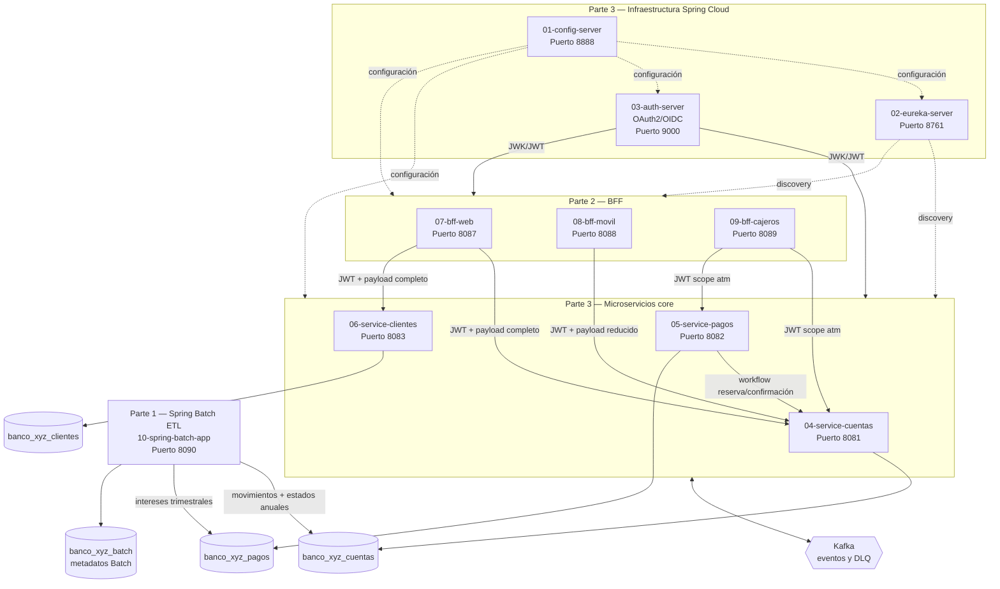

# Banco XYZ — Modernización Backend: Spring Cloud y Batch

Evaluación Final Transversal — Desarrollo Backend III — Duoc UC.

Plataforma que migra el sistema legacy COBOL/Shell del Banco XYZ hacia una
arquitectura de microservicios cloud-native, cubriendo los tres bloques del enunciado:
migración batch (Parte 1), patrón BFF (Parte 2) y microservicios resilientes
con Spring Cloud (Parte 3).

> **Documentación complementaria**
> - Ejecución y pruebas detalladas → [`instrucciones.md`](./instrucciones.md)
> - Despliegue en AWS → [`despliegue.md`](./despliegue.md)

---

## 1. Resumen ejecutivo

El workspace contiene diez proyectos Spring Boot independientes, cada uno con su
propio `pom.xml`, código fuente, configuración y Dockerfile. La solución separa:

- **Infraestructura Spring Cloud:** Config Server, Eureka Server y Auth Server.
- **Microservicios core:** cuentas, pagos y clientes, cada uno con su propia base de datos y API REST.
- **BFF (Backend for Frontend):** adaptadores especializados para web, móvil y cajeros automáticos.
- **ETL Spring Batch:** tres Jobs que migran los CSV legacy, normalizan datos y persisten los resultados en las bases de los microservicios core.

---

## 2. Cobertura del enunciado

### Parte 1 — Migración de procesos batch con Spring Batch

| Requerimiento | Implementación |
|---|---|
| Reescribir procesos en Spring Batch | `10-spring-batch-app`: 3 Jobs (`transaccionesDiariasJob`, `interesesTrimestralesJob`, `estadosFinancierosAnualesJob`) |
| Job con Steps: leer, procesar, escribir | `FlatFileItemReader` → `ItemProcessor` → `ItemWriter` idempotente por cada Job |
| Manejo de excepciones y reintentos | `faultTolerant().skipLimit(2000).skip(BatchDataException.class)` + `RejectSkipListener` |
| Grandes volúmenes — optimización | Chunk size 50; procesamiento por lotes con transacciones delimitadas |
| Políticas de finalización y reejecución | `spring.batch.job.enabled: true`; metadatos en `banco_xyz_batch` permiten relanzar por `JobParameters` únicos |
| Integridad durante migración | Writers idempotentes con restricciones `UNIQUE` en tablas destino |
| Resultados equivalentes al legacy | Normalización de 4 formatos de fecha, validación de montos, normalización de tipos |
| **Destino ETL** | Los datos migrados se escriben en `banco_xyz_cuentas` (movimientos + estados) y `banco_xyz_pagos` (intereses), usando múltiples DataSources |

**Fuente de datos:** archivos CSV del repositorio `KariVillagran/fin_legacy_data`, incluidos en `src/main/resources/data/`.

### Parte 2 — Patrón Backend for Frontend (BFF)

| Requerimiento | Implementación |
|---|---|
| BFF Web | `07-bff-web` (puerto 8087): payloads completos, agregación cliente + cuentas |
| BFF Móvil | `08-bff-movil` (puerto 8088): respuestas ligeras con campos esenciales |
| BFF Cajeros | `09-bff-cajeros` (puerto 8089): operaciones ATM con scope `atm` |
| Autenticación por canal | JWT Bearer Token validado con JWK Set del Auth Server; scope `atm` exclusivo para cajeros |
| BFFs independientes | Cada BFF es una aplicación Spring Boot separada; no comparten código |

### Parte 3 — Microservicios resilientes con Spring Cloud

| Requerimiento | Implementación |
|---|---|
| Microservicio de gestión de cuentas | `04-service-cuentas` (puerto 8081): apertura, cierre, consulta, mantenimiento |
| Microservicio de procesamiento de pagos | `05-service-pagos` (puerto 8082): pagos, transferencias, workflow compensatorio |
| Microservicio de gestión de clientes | `06-service-clientes` (puerto 8083): alta, consulta y administración de perfiles |
| Spring Cloud Config | `01-config-server` con perfil `native`; configuraciones en `configurations/` |
| Descubrimiento de servicios | `02-eureka-server`; todos los core y BFF se registran y descubren dinámicamente |
| Balanceo de carga y enrutamiento | Spring Cloud LoadBalancer integrado en los BFF y en service-pagos → service-cuentas |
| OAuth2 con Spring Security | `03-auth-server` (OAuth2 Authorization Server); todos los core y BFF validan JWT |
| Resilience4j | Circuit Breaker, TimeLimiter y Retry configurados en cada core service |
| Comportamientos alternativos (fallback) | Workflow compensatorio en pagos: reservar → confirmar → liberar ante fallo |
| Kafka — eventos | Topics: `pagos-procesados`, `cambios-cuenta`, `alertas-seguridad` |
| Kafka — productores y consumidores | Todos los core services producen y consumen eventos; consumidores idempotentes con DLQ |
| Docker Compose | `docker-compose.yml` orquesta las 10 aplicaciones + MySQL + Kafka + Zookeeper |
| Preparación para nube (AWS) | Dockerfiles en cada módulo; variables de entorno para toda la infraestructura |

---

## 3. Arquitectura



---

## 4. Estructura del proyecto

| Proyecto | Puerto | Parte | Propósito |
|---|---:|:---:|---|
| `01-config-server` | 8888 | 3 | Configuración centralizada con perfil `native`. |
| `02-eureka-server` | 8761 | 3 | Registro y descubrimiento de servicios. |
| `03-auth-server` | 9000 | 3 | OAuth2 Authorization Server / OIDC, emisión de JWT. |
| `04-service-cuentas` | 8081 | 3 | Apertura, cierre, consulta y mantenimiento de cuentas. |
| `05-service-pagos` | 8082 | 3 | Pagos, transferencias y depósitos; workflow compensatorio. |
| `06-service-clientes` | 8083 | 3 | Alta, consulta y administración de perfiles de clientes. |
| `07-bff-web` | 8087 | 2 | Agregación para navegador y payloads completos. |
| `08-bff-movil` | 8088 | 2 | Payloads ligeros para aplicaciones móviles. |
| `09-bff-cajeros` | 8089 | 2 | Operaciones ATM de baja latencia y scope `atm`. |
| `10-spring-batch-app` | 8090 | 1 | ETL: migra CSV legacy hacia las bases de los microservicios core. |

---

## 5. Base de datos MySQL

Un único servidor MySQL con cuatro esquemas lógicos. El Batch actúa como ETL y
escribe los datos migrados directamente en las bases transaccionales:

| Esquema | Quién escribe | Quién lee | Tablas principales |
|---|---|---|---|
| `banco_xyz_cuentas` | Spring Batch + service-cuentas | service-cuentas | `cuentas`, `movimientos_financieros_diarios`, `estados_financieros_anuales` |
| `banco_xyz_pagos` | Spring Batch + service-pagos | service-pagos | `pagos`, `intereses_trimestrales` |
| `banco_xyz_clientes` | service-clientes | service-clientes | `clientes` |
| `banco_xyz_batch` | Spring Batch | — | Metadatos de ejecución Batch |

El script `docker/mysql/init/01-create-core-databases.sql` crea los cuatro esquemas
al levantar el contenedor. JPA con `ddl-auto: update` crea las tablas al arrancar cada servicio.

---

## 6. Despliegue rápido con Docker Compose

```powershell
docker compose up --build
```

El stack completo levanta MySQL, Zookeeper, Kafka, Config Server, Eureka, Auth Server,
los tres core services, los tres BFF y el Batch. En segundo plano:

```powershell
docker compose up --build -d
docker compose ps
docker compose logs -f service-cuentas
```

Para detener:

```powershell
docker compose down        # conserva volúmenes
docker compose down -v     # elimina también los datos
```

---

## 7. Comparación legacy vs. plataforma modernizada

| Aspecto | Legacy COBOL/Shell | Plataforma modernizada |
|---|---|---|
| Despliegue | Procesos acoplados en mainframe | 10 contenedores Docker independientes |
| Configuración | Embebida en scripts | Spring Cloud Config Server |
| Descubrimiento | Direcciones IP estáticas | Eureka + Spring Cloud LoadBalancer |
| Canales de consumo | Lógica mezclada en el monolito | BFF web, móvil y ATM independientes |
| Seguridad | Validación manual o distribuida | OAuth2 / OIDC + JWT en todos los endpoints |
| Comunicación | Procesos secuenciales en archivos | APIs REST + eventos Kafka |
| Tolerancia a fallos | Reejecución manual | Circuit Breaker, Retry, TimeLimiter, compensación |
| Proceso batch | Sin control transaccional uniforme | Jobs con chunks, skip, DLQ e idempotencia |
| Destino de datos migrados | Archivos planos | Bases transaccionales MySQL de cada microservicio |
| Escalabilidad | Vertical (hardware mainframe) | Horizontal (réplicas por contenedor o pod K8s) |

---

## 8. Resiliencia y consistencia

- **Circuit Breaker, TimeLimiter y Retry** configurados en cada core service vía Resilience4j.
- **Workflow compensatorio en pagos:** reservar fondos → registrar pago → confirmar reserva → liberar ante cualquier fallo.
- **Kafka idempotente:** tabla `ProcessedEvent` por servicio evita reprocesar el mismo evento.
- **Topics DLQ** para eventos que superan el límite de reintentos.
- **Transacciones JPA** con `@Transactional` en todos los casos de uso que modifican estado.
- **Spring Batch idempotente:** restricciones `UNIQUE` en tablas destino; el Job puede relanzarse sin duplicar datos.
