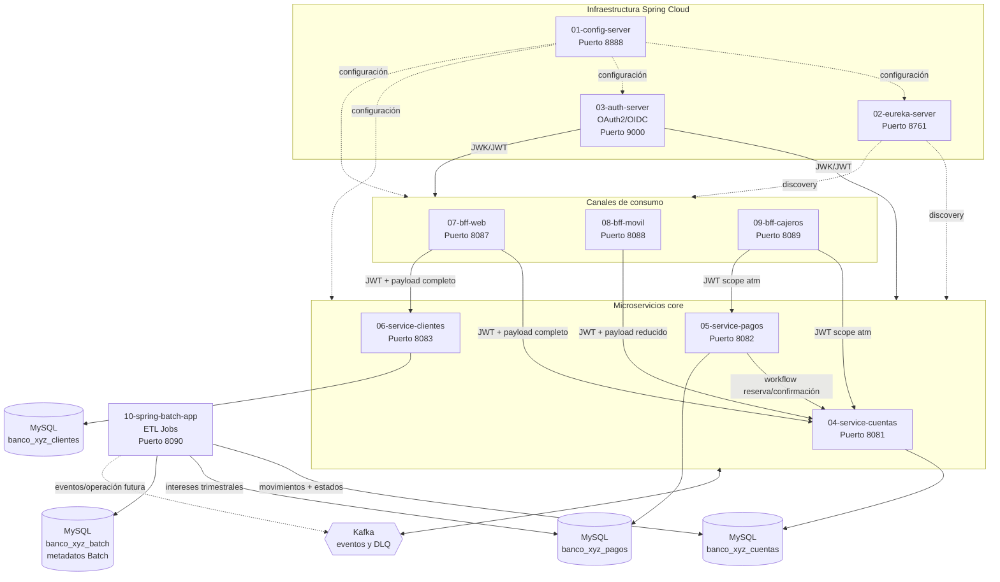

# Banco XYZ - EFT Semana 9

Plataforma de modernización del procesamiento financiero legacy del Banco XYZ. El
workspace está organizado como diez proyectos Spring Boot independientes, cada
uno con su propio `pom.xml`, código fuente, configuración y Dockerfile.

## 1. Resumen ejecutivo

El objetivo es evolucionar procesos legacy basados en COBOL/Shell hacia una
arquitectura distribuida, desacoplada y preparada para ejecución cloud-native.
La solución separa:

- **Infraestructura Spring Cloud:** Config Server, Eureka Server y Auth Server.
- **Microservicios core:** cuentas, pagos y clientes, cada uno con su propia
  persistencia y API.
- **BFF (Backend for Frontend):** adaptadores especializados para web, móvil y
  cajeros automáticos.
- **Migración batch:** tres Jobs Spring Batch para procesar archivos CSV legacy,
  normalizar datos, descartar anomalías y persistir resultados en MySQL.

Los microservicios core usan JPA y transacciones explícitas, JWT como mecanismo
de autenticación, Kafka para eventos, Resilience4j para tolerancia a fallos y
persistencia aislada. Los BFF no implementan reglas de negocio del banco:
transforman respuestas, agregan datos cuando corresponde y adaptan el payload al
canal consumidor.

## 2. Arquitectura



Los eventos Kafka usan un envelope con `id`, `tipo`, `fecha`, `version` y
`payload`. Los consumidores guardan identificadores procesados para evitar
duplicados y usan reintentos acotados con tópicos DLQ.

## 3. Estructura del proyecto

| Proyecto | Puerto | Propósito |
|---|---:|---|
| `01-config-server` | 8888 | Configuración centralizada con perfil `native` y carpeta `configurations/`. |
| `02-eureka-server` | 8761 | Registro y descubrimiento de servicios; no se registra a sí mismo. |
| `03-auth-server` | 9000 | OAuth2 Authorization Server/OIDC, emisión de JWT y JWK Set. |
| `04-service-cuentas` | 8081 | Apertura, cierre, consulta y mantenimiento de cuentas. |
| `05-service-pagos` | 8082 | Pagos, transferencias y depósitos; workflow compensatorio. |
| `06-service-clientes` | 8083 | Alta, consulta y administración de perfiles de clientes. |
| `07-bff-web` | 8087 | Agregación para navegador y payloads completos. |
| `08-bff-movil` | 8088 | Payloads ligeros para aplicaciones móviles. |
| `09-bff-cajeros` | 8089 | Operaciones ATM de baja latencia y scope `atm`. |
| `10-spring-batch-app` | 8090 | ETL: tres Jobs que migran CSV legacy hacia las bases de los microservicios core. |

Cada proyecto es independiente. No se comparte una base de datos entre
microservicios core: la comunicación entre dominios se realiza mediante APIs y
eventos.

## 4. Ejecución local paso a paso

### 4.1 Requisitos

- JDK 17.
- Maven 3.9+.
- MySQL 8.x (un único servidor para todos los servicios; los esquemas se crean automáticamente).
- Kafka y Zookeeper para mensajería.
- Postman o `curl`.

### 4.2 Inicializar MySQL

Todos los servicios (core + batch) usan un único servidor MySQL. El Batch actúa como ETL y escribe los datos migrados directamente en las bases de los microservicios core:

| Base de datos | Quién escribe | Quién lee |
|---|---|---|
| `banco_xyz_cuentas` | Spring Batch (movimientos diarios + estados anuales) | service-cuentas |
| `banco_xyz_pagos` | Spring Batch (intereses trimestrales) | service-pagos |
| `banco_xyz_clientes` | service-clientes (vía API) | service-clientes |
| `banco_xyz_batch` | Spring Batch (metadatos de ejecución) | — |

El script `docker/mysql/init/01-create-core-databases.sql` crea automáticamente los cuatro esquemas al levantar el contenedor. Para desarrollo local sin Docker, crearlos manualmente:

```sql
CREATE DATABASE IF NOT EXISTS banco_xyz_cuentas;
CREATE DATABASE IF NOT EXISTS banco_xyz_pagos;
CREATE DATABASE IF NOT EXISTS banco_xyz_clientes;
CREATE DATABASE IF NOT EXISTS banco_xyz_batch;
```

El Batch usa `spring.jpa.hibernate.ddl-auto: update` en cada DataSource, por lo que crea las tablas `movimientos_financieros_diarios`, `estados_financieros_anuales` e `intereses_trimestrales` al arrancar. Spring Batch crea sus tablas de metadatos en `banco_xyz_batch` con `spring.batch.jdbc.initialize-schema: always`.

Credenciales por defecto (sobrescribibles con variables de entorno):

| Variable | Valor por defecto |
|---|---|
| `DB_BATCH_URL` | `jdbc:mysql://localhost:3306/banco_xyz_batch?...` |
| `DB_CUENTAS_URL` | `jdbc:mysql://localhost:3306/banco_xyz_cuentas?...` |
| `DB_PAGOS_URL` | `jdbc:mysql://localhost:3306/banco_xyz_pagos?...` |
| `DB_USERNAME` | `root` |
| `DB_PASSWORD` | `admin` |

### 4.3 Compilar todos los proyectos

Ejecutar desde la raíz:

```powershell
Get-ChildItem -Directory | Where-Object { Test-Path "$($_.FullName)\pom.xml" } |
  ForEach-Object { Push-Location $_.FullName; mvn -B clean install; Pop-Location }
```

También puede compilarse cada aplicación individualmente:

```powershell
Set-Location .\04-service-cuentas
mvn -B clean install
```

Repetir el comando cambiando el directorio por cada proyecto. Los artefactos
`target/` están excluidos de Git.

### 4.4 Orden recomendado de arranque

1. MySQL, Kafka y Zookeeper.
2. `01-config-server`.
3. `02-eureka-server`.
4. `03-auth-server`.
5. `04-service-cuentas`, `05-service-pagos` y `06-service-clientes`.
6. `07-bff-web`, `08-bff-movil` y `09-bff-cajeros`.
7. `10-spring-batch-app`, cuando MySQL esté disponible.

Ejemplo:

```powershell
Set-Location .\01-config-server
mvn spring-boot:run
```

En otra terminal:

```powershell
Set-Location .\02-eureka-server
mvn spring-boot:run
```

Usar el mismo patrón para las aplicaciones restantes. Las variables `SERVER_PORT`,
`EUREKA_URI`, `AUTH_JWK_SET_URI`, `KAFKA_BOOTSTRAP_SERVERS` y las variables de
base de datos permiten cambiar la infraestructura sin modificar el código.

### 4.5 Verificaciones rápidas

#### Salud de infraestructura

```http
GET http://localhost:8888/actuator/health
GET http://localhost:8761/actuator/health
GET http://localhost:9000/actuator/health
GET http://localhost:8081/actuator/health
```

Se espera una respuesta HTTP `200` con un estado de salud `UP`.

#### Solicitar un token en Auth Server

La configuración de desarrollo utiliza el cliente registrado en Auth Server.
En Postman:

1. Crear una petición `POST`.
2. URL: `http://localhost:9000/oauth2/token`.
3. Authorization: **Basic Auth** con `eft-client` y el secreto configurado en
   `03-auth-server`.
4. Body `x-www-form-urlencoded`:

```text
grant_type=client_credentials
scope=openid profile
```

La respuesta esperada contiene:

```json
{
  "access_token": "<JWT>",
  "token_type": "Bearer",
  "expires_in": 3600
}
```

Copiar `access_token` y usarlo como `Bearer Token` en las siguientes peticiones.
Si el perfil de autenticación local exige usuario/contraseña, utilizar las
credenciales declaradas en la configuración de desarrollo del Auth Server.

#### Crear y consultar un cliente

```http
POST http://localhost:8083/api/v1/clientes
Authorization: Bearer <JWT>
Content-Type: application/json
```

```json
{
  "rut": "11111111-1",
  "nombres": "Ana",
  "apellidos": "Pérez",
  "email": "ana.perez@example.com",
  "telefono": "+56911111111"
}
```

Se espera `201 Created` con un `id` UUID, los datos completos y `creadoEn`.
Luego:

```http
GET http://localhost:8083/api/v1/clientes/{id}
Authorization: Bearer <JWT>
```

#### Abrir y consultar una cuenta

```http
POST http://localhost:8081/api/v1/cuentas
Authorization: Bearer <JWT>
Content-Type: application/json
```

```json
{
  "clienteId": "<UUID_DEL_CLIENTE>",
  "numero": "001-000001",
  "tipo": "AHORRO"
}
```

Se espera `201 Created` con `id`, `clienteId`, `numero`, `tipo`, `saldo`,
`estado` y `creadaEn`. Para consultar:

```http
GET http://localhost:8081/api/v1/cuentas/cliente/{clienteId}
Authorization: Bearer <JWT>
```

#### Registrar un pago

```http
POST http://localhost:8082/api/v1/pagos
Authorization: Bearer <JWT>
Content-Type: application/json
```

```json
{
  "cuentaOrigenId": "<UUID_CUENTA_ORIGEN>",
  "cuentaDestinoId": "<UUID_CUENTA_DESTINO>",
  "monto": 1000.00,
  "tipo": "TRANSFERENCIA"
}
```

El flujo intenta reservar fondos, registrar el pago y confirmar la reserva. Si
una etapa falla, intenta liberar la reserva. La respuesta exitosa es `201
Created` con `id`, cuentas, monto, tipo, estado y `creadoEn`.

#### Probar BFF Web

```http
GET http://localhost:8087/api/v1/web/clientes/{clienteId}/dashboard
Authorization: Bearer <JWT>
```

Se espera un payload agregado con datos completos del cliente y sus cuentas.

#### Probar BFF Móvil

```http
GET http://localhost:8088/api/v1/mobile/clientes/{clienteId}/resumen
Authorization: Bearer <JWT>
```

Se espera una lista ligera con campos esenciales, como `id`, `numero` y
`saldo`.

#### Probar BFF Cajeros

El token debe incluir el scope `atm`:

```http
GET http://localhost:8089/api/v1/atm/cuentas/{cuentaId}/saldo
Authorization: Bearer <JWT>
```

Se espera un payload mínimo con `cuentaId`, `saldo` y `estado`. Un token sin
`SCOPE_atm` recibe `403 Forbidden`.

#### Ejecutar los Jobs Batch

Con MySQL disponible:

```powershell
Set-Location .\10-spring-batch-app
mvn spring-boot:run
```

Los archivos leídos son:

- `src/main/resources/data/movimientos_financieros_diarios.csv`
- `src/main/resources/data/intereses_trimestrales.csv`
- `src/main/resources/data/estados_financieros_anuales.csv`

La prueba automatizada:

```powershell
mvn -B test
```

verifica los tres Jobs, su estado `COMPLETED` y la persistencia de registros.
Los datos rechazados se escriben en
`target/rejects/batch-rejections.log`.

## 5. Despliegue con Docker Compose

El archivo [docker-compose.yml](./docker-compose.yml) orquesta las diez
aplicaciones y los servicios de soporte:

```powershell
docker compose up --build
```

Para ejecutarlo en segundo plano:

```powershell
docker compose up --build -d
docker compose ps
docker compose logs -f service-pagos
```

La red compartida se llama `banco-network`. Dentro de ella los contenedores se
resuelven por nombre de servicio:

- `config-server:8888`
- `eureka-server:8761`
- `auth-server:9000`
- `mysql:3306`
- `kafka:29092`

Por eso, dentro de Compose se usan nombres como `kafka:29092` y
`jdbc:mysql://mysql:3306/...`, no `localhost`.

`host.docker.internal` debe utilizarse únicamente cuando un contenedor necesite
conectarse a un servicio que permanece ejecutándose en la máquina anfitriona,
por ejemplo una base MySQL local externa al Compose:

```text
DB_URL=jdbc:mysql://host.docker.internal:3306/banco_xyz_batch
```

En la configuración entregada, todos los servicios (core + batch) usan el mismo
contenedor `mysql`, cada uno apuntando a su propia base de datos lógica, por lo
que no necesitan `host.docker.internal`.

Para detener y eliminar contenedores sin borrar volúmenes:

```powershell
docker compose down
```

Para eliminar también los datos persistentes:

```powershell
docker compose down -v
```

## 6. Resultados y comparación con el legacy

### Resultados comprobados

- Los tres Jobs Spring Batch ejecutan procesamiento por chunks de **50**
  registros.
- Las pruebas automatizadas cubren **3 Jobs**, con resultado `COMPLETED`,
  **0 errores** y **0 fallos** en la última ejecución registrada.
- Los CSV se procesan con normalización de cuatro formatos de fecha, validación
  de montos, normalización de dominios y registro de rechazos.
- La idempotencia se implementa con identificadores de origen y restricciones
  únicas en las tablas de negocio.
- Los tres BFF compilan correctamente y propagan el JWT hacia llamadas
  load-balanced a los servicios core.
- Los tres servicios core compilan correctamente con JPA, Resource Server,
  Kafka, Resilience4j, Config Client y Eureka Client.

### Resiliencia y consistencia

- Circuit Breaker, TimeLimiter y Retry tienen límites explícitos.
- El workflow de pagos implementa compensación: reservar fondos, registrar,
  confirmar y liberar ante fallo.
- Kafka utiliza eventos versionados, consumidores idempotentes, reintentos y
  DLQ.
- Las transacciones JPA se delimitan con `@Transactional`.
- Cada core mantiene su persistencia aislada; no consulta la base de otro
  microservicio.

### Comparación conceptual

| Aspecto | Legacy COBOL/Shell | Plataforma modernizada |
|---|---|---|
| Despliegue | Procesos acoplados y orientados a archivos | Diez aplicaciones independientes |
| Configuración | Local o embebida en scripts | Config Server |
| Descubrimiento | Direcciones estáticas | Eureka + Spring Cloud LoadBalancer |
| Canales | Lógica mezclada con backend | BFF web, móvil y ATM |
| Seguridad | Validación distribuida o manual | Auth Server y JWT/OIDC |
| Integración | Procesos secuenciales | APIs HTTP y eventos Kafka |
| Fallos | Reejecución manual | Circuit Breaker, Retry, TimeLimiter y compensación |
| Datos batch | Archivos sin control transaccional uniforme | Chunks, transacciones, skip listener e idempotencia |
| Auditoría | Logs dispersos | Eventos versionados y DLQ |

No se ha ejecutado todavía una prueba de carga formal; por tanto, no se afirma
un throughput o latencia de producción. Para completar esa métrica se recomienda
medir con JMeter o k6: solicitudes por segundo, p95/p99, tasa de errores,
tiempo de recuperación del Circuit Breaker y duración de cada Job con el
volumen real de archivos.


